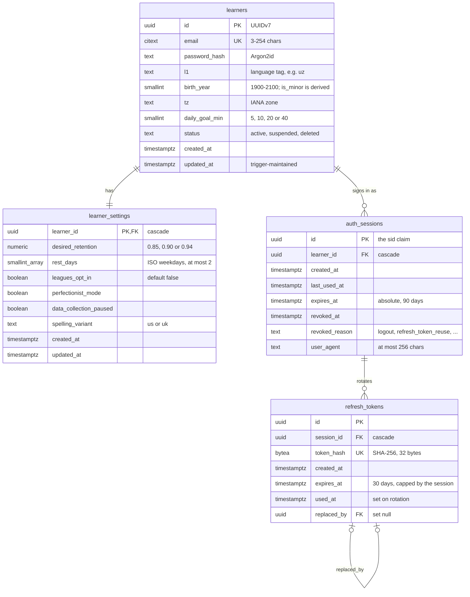
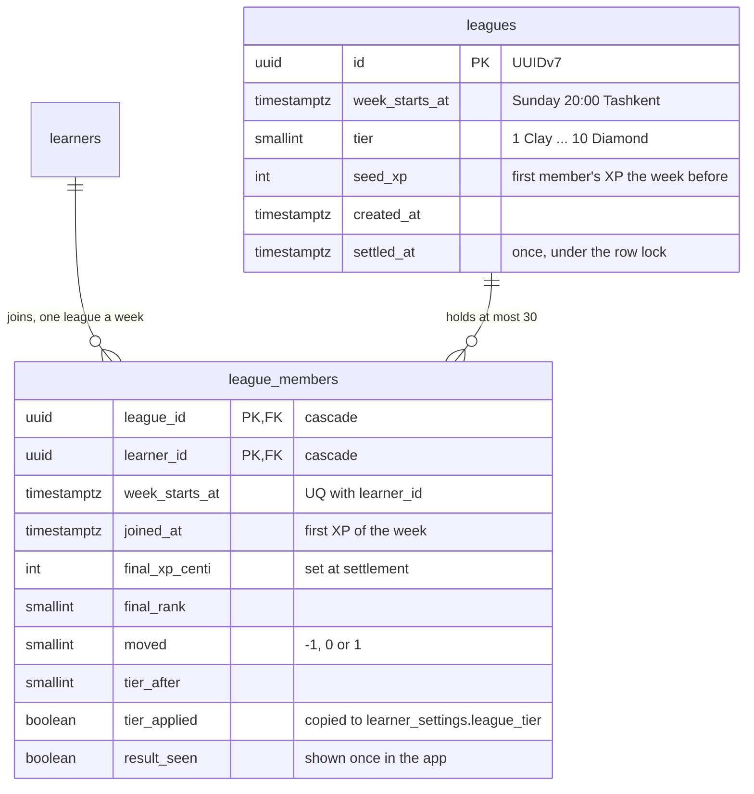

# Data model

Phase 1 tables exist now (migration `0001_identity_baseline`). The rest is the plan for
Phases 2–8, in the order the build brief (§15) introduces them. The reasons for each
deviation from brief §5 are in [DECISIONS.md](../DECISIONS.md).

## Phase 1 — identity (implemented)



| Index | Serves |
|---|---|
| `uq_learners_email` (citext) | sign-in lookup, case-insensitive uniqueness |
| `uq_refresh_tokens_token_hash` | refresh and logout lookup |
| `ix_auth_sessions_learner_id` | a learner's sessions; cascade on learner deletion |
| `ix_auth_sessions_expires_at`, `ix_auth_sessions_revoked_at` (partial) | the daily purge |
| `ix_refresh_tokens_session_id` | cascade from sessions |
| `ix_refresh_tokens_expires_at` | the daily purge |
| `ix_refresh_tokens_replaced_by` (partial) | `ON DELETE SET NULL` without a scan |

Privileges: the tables belong to the migration role; `lep_app_rw` has SELECT, INSERT,
UPDATE and DELETE on them and nothing else.

## Phases 2–8 (planned)

```
CONTENT — Phase 2
content_versions (id PK, syllabus_version, content_hash UQ, item_count, published_at)
learner_content  (learner_id, section_id) PK → content_versions      pinned per section (docs/11 §9)

LEARNING — Phases 4–5
review_ingest_keys (learner_id, client_uuid) PK → attempt (ts, id)   idempotency
review_attempts    (learner_id, ts, id) PK       one row per answer            append-only
  client_uuid · item_id · session_id · content_version · answer_raw · rt_ms · hints
  correct · error_type · offline · client_version · ingested_at
review_log         (learner_id, ts, id) PK       one row per memory item touched  append-only
  attempt_id → review_attempts · memory_item_id · grade 1–4 · scheduler_version
  client_s · client_d (logged for comparison, never used)
memory_state       (learner_id, memory_item_id) PK   derived by replay only
  syllabus_id (generated) · stability · difficulty · due · last_review · reps · lapses
  state · params_version · last_item_id · last_type_id · contexts_seen · productive_uses
node_attempts · unit_progress · section_progress · answer_disputes

ASSESSMENT — Phase 7
assessment_sessions 1─N assessment_responses · rubric_scores · level_awards
rater_calibrations (rater_version, level, task_type) PK · qwk        the κ ≥ 0.75 gate

GAMIFICATION — Phase 6
xp_ledger (append-only) · streaks 1─1 · quests · badges · cohorts ⟷ cohort_members
leagues ⟷ league_members (opt-in) · immersion_events (append-only; docs/00 §3.3)

MEDIA AND AI — Phase 8
media_assets · speech_submissions · writing_submissions · ai_usage_daily (cost ceiling)
```

## Leagues (implemented, migration `0010_leagues`)



`learners.display_name` (2–24 characters, none by default) and `learner_settings.league_tier`
/ `leagues_left_at` came with them. The weekly XP is read from `xp_events` (`regrind = false`)
through `ix_xp_events_learner_id_ts`; `ix_leagues_unsettled` (partial) serves the Sunday job.

## `review_log`: partitioning and indexes (Phase 4)

* **Two append-only tables.** `review_attempts` holds one row per answer and carries the
  idempotency key. `review_log` holds one row per memory item the answer touched, which
  is all that replay reads.
* **Range-partitioned by month on `ts`**, both tables, from the first migration. A beat
  task keeps three months of partitions ahead. A DEFAULT partition catches bad client
  clocks and raises an alert whenever it is not empty. Monthly rather than hashed by
  learner, so inserts land in a small, hot index instead of random pages of the whole
  history.
* **Keys.** PostgreSQL requires every unique constraint on a partitioned table to
  include the partition key, so the primary key is `(learner_id, ts, id)`. That is also
  the replay index, so brief §5.2's `(learner_id, ts)` index comes free. One secondary
  index, `(learner_id, memory_item_id, ts) INCLUDE (grade, item_id)`, answers per-item
  history (leech checks, "a type not used in the last 3 failures") from the index alone.
* **Idempotency** lives in `review_ingest_keys (learner_id, client_uuid)`, an ordinary
  table, because a unique `client_uuid` cannot be enforced across partitions without
  `ts` in the key. It also lets a retried request return the original grade instead of
  grading again.
* **Append-only** is enforced by BEFORE UPDATE/DELETE and BEFORE TRUNCATE triggers that
  raise, plus INSERT and SELECT only for the API's role. The one delete path is the
  erasure job (docs/11 §10), under a separate role.
* **`memory_state`** is hash-partitioned by `learner_id` (64 partitions): every query is
  per learner, and at 5 M monthly learners it holds billions of rows. The due-queue
  index is brief §5.2's partial index,
  `(learner_id, due) WHERE state NOT IN ('suspended', 'retired')`.
